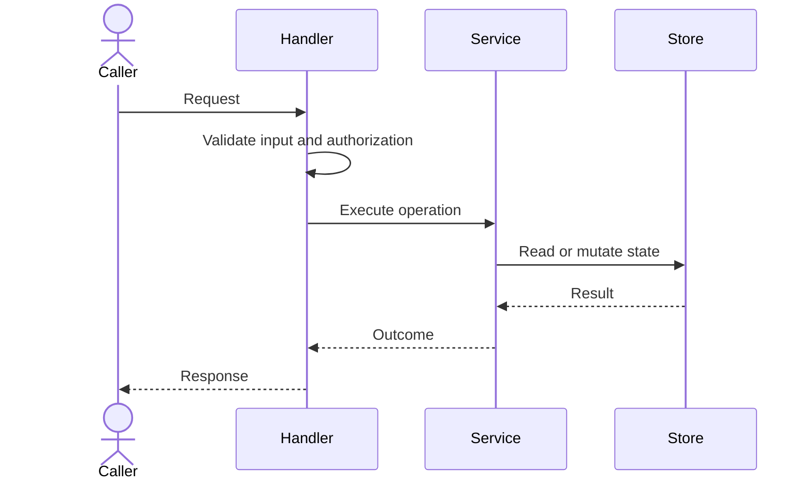

# Creating flow docs

Document one operation's observable behavior using the project's existing flow-document convention.

## Establish the convention

Read the local conventions and one or two existing flows. Match language, filenames, section order, actor names, and diagram format. Use an ordinal only when that convention exists.

Flow docs cover operations, queries, scheduled work, and implementation gaps. Use architecture docs for system-wide structure and runbooks for operational procedures.

## Choose the variant

| Variant | Purpose | Distinct sections |
|---|---|---|
| Write/action | State-changing operation | Preconditions, mutations, optional state diagram |
| Read/query | Read and return data | Preconditions, result shape, filtering/pagination |
| System/cron | Scheduled or event-triggered work | Trigger and scheduling conditions |
| Gap/legacy | Expected behavior differs from implementation | Current behavior, impact, current flow, recommended fix, verification |

Use the gap sections instead of forcing a normal-operation template onto a defect report.

## Trace the behavior

Inspect the implementation and tests before drafting. Determine:

- initiating actor or trigger;
- actual feature gates and authorization;
- inputs, required headers, and entity-state conditions;
- service interactions and persistence effects;
- conditional events and best-effort side effects;
- success result, failures, retries, and concurrency risks.

Do not invent a feature flag or error code to fill a template. Separate verified current behavior from a proposed change.

## Normal-operation template

Use this fallback only when no local convention supplies one:

1. **Title** — operation name.
2. **What happens** — actor, operation, and outcome in one or two sentences.
3. **Participants** — actors, services, storage, and messaging in interaction order.
4. **Preconditions / When triggered** — actual gates, authorization, inputs, existence, and state.
5. **What changes / What returns** — mutations or result shape; identify conditional and best-effort effects.
6. **Sequence** — the main interaction path.
7. **Branching / State** — only when they add information missing from the sequence.
8. **Errors** — caller-visible failures; for jobs, observable failure and retry behavior.
9. **Caveats** — concrete race windows, partial effects, and limitations.

Read operations and scheduled jobs can fail. Do not omit their error contract.

## Diagrams

Use Mermaid alone unless the project requires paired Mermaid/PlantUML diagrams. When paired, keep semantics identical; do not add a twin to a Mermaid-only project.

- Sequence diagrams show participants and causal ordering.
- Branching diagrams show meaningful decisions and named outcomes.
- State diagrams show valid transitions when state is part of the contract.
- Label asynchronous and best-effort effects explicitly rather than relying on arrow style alone.

A sequence fallback:

Replace generic names and interactions with verified ones. Add actual conditional failures and effects.

## Write and connect

Use one language for prose. Keep exact identifiers distinct from translated labels.

Keep flow contracts about RPCs, fields, flags, services, and observable behavior. Retain source evidence in the review record rather than making the published contract depend on line numbers.

Link the new flow from the existing index. Update existing companion docs only when an operation or invariant changes. Do not create a separate architecture tree merely to complete this procedure.

## Verify

- Behavior matches current code/tests or is explicitly marked proposed.
- Preconditions include only real gates.
- Every mutation, result, conditional emission, and failure has the intended meaning.
- Errors cover the selected variant.
- Diagrams agree with prose and local pairing rules.
- Index links resolve; no contradictory companion contract remains.

See [[z-domain-modeling]], [[z-concise-human-docs]].
